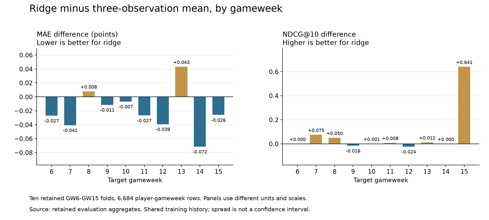

# Variation across the retained gameweeks

This analysis reuses the ten GW6-GW15 fold records in the unchanged [retained evaluation](../../reports/retained/2024-25-gw01-15-evaluation.json). [Per-gameweek differences](per-gameweek.csv) contain paired metrics, and [comparison.json](comparison.json) records the source report SHA-256 and full descriptive summaries. No new source data, model fitting, or player predictions are involved.

Compared with the three-observation mean, ridge has lower MAE in 8 of 10 gameweeks, lower RMSE in all 10, and higher Spearman in all 10. Each gameweek receives equal weight here.



| Ridge minus three-observation mean | Mean difference | Gameweek standard deviation | Leave-one-gameweek-out mean range |
|---|---:|---:|---:|
| MAE, lower is better | -0.01990 | 0.03090 | -0.02691 to -0.01416 |
| RMSE, lower is better | -0.21475 | 0.04776 | -0.22405 to -0.20824 |
| Spearman, higher is better | 0.02531 | 0.01311 | 0.02320 to 0.02713 |
| NDCG@10, higher is better | 0.07467 | 0.20102 | 0.01179 to 0.08558 |

The MAE improvement is small relative to its gameweek variation. NDCG@10 is especially variable: omitting its strongest gameweek reduces the mean improvement to 0.01179. The leave-one-gameweek-out range shows sensitivity to individual weeks; it is not a confidence interval or an estimate of performance on unseen seasons. The folds share expanding training history and cannot be treated as ten independent experiments.

The original coverage rule selected the longest season-opening interval passing 0.90 adjacent-player coverage. GW15-GW16 coverage was 0.8987, so these results give no evidence about the remainder of the season. Missing source and prediction rows prevent player, position, minutes, fixture, blank/double-gameweek, and availability subgroup analysis or calibrated player-level uncertainty. Aggregate row counts cannot establish those groups.

The retained run predates the stricter duplicate player/fixture rejection in release 3. Its source manifest and metrics remain historical evidence; the missing raw rows prevent retrospective verification of that new check.

Rebuild only these derived files from the project directory:

```bash
uv run --locked python -m fpl_forecasting.retained --report reports/retained/2024-25-gw01-15-evaluation.json --output-dir results/retained-folds
```

The original dependency-free overview builder still runs without analysis dependencies. To rebuild
the additional Matplotlib chart, use `uv sync --locked --extra analysis` and
`uv run --locked python analysis/build_walkthrough.py --folds`.
