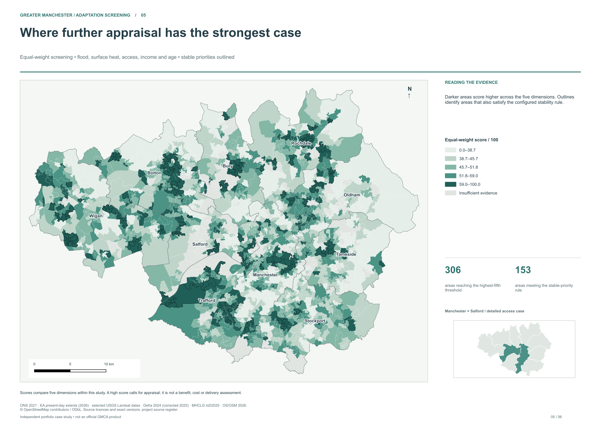
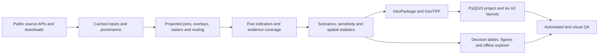

# Greater Manchester Climate Resilience

**A reproducible geospatial consultancy case study that turns open environmental and social data into a neighbourhood investigation shortlist—and tests how much that shortlist depends on the assumptions.**

[](outputs/maps/05_priorities.png)

*The 153 outlined neighbourhoods meet the declared persistence rule; 174 grey areas lack sufficient usable heat coverage and remain unassessed.*

Independent simulated commission · 1,702 neighbourhoods · Python + QGIS 4 · real open data

## The decision

An adaptation team has limited capacity for detailed local studies. Where should it investigate first, what pressures need attention, and which places move up or down when policy priorities change?

This project screens Greater Manchester using flood footprints, selected satellite surface temperatures, large-greenspace access, income deprivation and age structure. A detailed Manchester–Salford walking-network study adds operational evidence. The deliverable is a reviewable investigation programme, rather than a claim that an index proves where money will deliver the greatest benefit.

## Findings that change the next action

**Start local investigations with a stable shortlist.** The balanced screen places 306 of the 1,528 assessed neighbourhoods in its top fifth. Of those, **153 also remain in the top fifth under all three policy scenarios and at least 80% of 2,000 sampled weight configurations**. They are a starting set for local appraisal, not a prediction of harm or a funding allocation. The 153 areas contain 257,388 Census residents; that is an area population, not a count of people harmed.

**Investigate missing evidence alongside high scores.** Another **174 of the 1,702 neighbourhoods lack sufficient usable heat coverage** and are unassessed, not low priority. The gaps are uneven: Salford has 119 of 161 LSOAs assessed, while Wigan has 192 of 200. The grey areas on the map therefore need an evidence-improvement track before a programme can claim complete regional coverage. [Inspect the evidence-gap table](outputs/tables/evidence_gaps.csv).

**Test the decision against its assumptions.** Similar overall scenario rankings can still produce different top-group lists: balanced versus hazard-emphasis top-group Jaccard overlap is 0.545 (1 would mean identical lists). Replacing midranks with raw min–max scaling lowers balanced top-group overlap to **0.464**. The declared weight-persistence rule does not make the shortlist independent of indicator definitions or normalisation. [View the sensitivity figure](outputs/figures/weight_sensitivity.png) and [methodology](docs/methodology.md).

The [Manchester–Salford walking-access map](outputs/maps/04_accessibility.png) adds an operational check: 60.7% of represented residents have a finite mapped route longer than 1 km to a qualifying public park, while another 2.3% are represented by origins with no mapped route. Those 54 disconnected origins need a local network-data audit before operational use. The reported combined deficit is 63.0%; mapped access is not an observed journey.

The [client decision brief](docs/client_brief.md) turns these findings into investigation workstreams. The [full shortlist](outputs/tables/priority_shortlist.csv) contains all 306 balanced top-group areas, including the 153 weight-persistent priorities; the other 153 are scenario-sensitive. Spatial association is also tested: Global Moran's I = 0.504, two-sided permutation p = 0.0001. It describes clustering, not a causal explanation or locally significant hotspots.

## Open the deliverables

| Deliverable | Entry point |
| --- | --- |
| QGIS project source | [gm_climate_resilience.qgz](qgis/project/gm_climate_resilience.qgz) — requires the processed data supplied in the complete handover |
| Complete QGIS handover | [Download the review ZIP](https://github.com/EwanMoorcroft/Ewan-Moorcroft-Portfolio/releases/download/gm-climate-resilience-v1.0.0/gm_climate_resilience_review.zip) — processed data, editable project and full map PDFs |
| Six A3 map pairs | [Maps](outputs/maps/) — PNG previews; PDFs supplied in the complete handover |
| Standalone interactive explorer | [interactive.html](outputs/portfolio/interactive.html) — download, then open locally; search `E01006261` and compare scenario ranks and heat coverage |
| Four analytical figure pairs | [Figures](outputs/figures/) — SVG and PNG |
| All indicators, shortlist, gaps and borough summaries | [Tables](outputs/tables/) |
| Source register and snapshot provenance | [Data sources](docs/data_sources.md), [catalogue](metadata/data_catalogue.csv), [manifest](metadata/provenance_manifest.json) |
| Real-data verification | [Validation summary](docs/validation.md), [machine QA](outputs/qa/validation.json) |

Keep `qgis/` and `data/processed/` in their relative hierarchy when opening the prebuilt project. Processed data are excluded from ordinary Git; a clone needs the reconstruction commands or the complete handover archive. The offline HTML embeds its geometry and values and needs no hosted service.

## Engineering and analytical depth

The work combines API pagination and immutable source checksums; streamed spreadsheet ingestion; validated statistical joins; exact flood intersections without overlap double-counting; QA-masked raster windows and fractional zonal statistics; entrance-based directed network routing; reproducible scenario and rank-sensitivity analysis; permutation inference; and substantial PyQGIS automation.

The network model preserves OSM node topology and pedestrian permissions, accounts for partial-edge and off-network connector distances, and distinguishes unreachable origins from unknown ones. The thermal pipeline centres dates on a fixed shared reference footprint, counts observations and withholds unsupported LSOA scores. Tests cover hand-checkable calculations and failure cases rather than merely checking that files exist.

The QGIS builder creates the grouped layer tree, aliases, metadata, map tips, reusable QML styles, expressions, map themes and six layouts. A reusable Processing algorithm exposes weighted scoring of already-normalised fields. Relative paths and relocation are checked. See [QGIS implementation](docs/qgis_project.md).

The delivered snapshot passes **77 tests and 267 real-data checks**. All 21 QGIS layers resolve, and all six layouts render identically after relocation. Every map PNG and independently rendered PDF was visually reviewed. The [validation record](docs/validation.md) distinguishes these checks from scientific and field-validation limits.



## Data and choices

Inputs come from **ONS Census/geography, MHCLG IoD2025, Environment Agency, Defra, OS Open Greenspace, USGS Landsat and OpenStreetMap**. The full [source register](docs/data_sources.md) links original publishers and records versions, licences, coverage and limitations.

Regional comparison uses Census 2021 LSOAs. Distance and area calculations use EPSG:27700. Landsat evidence comprises five selected summer days from 2021–2025 on a 100 m analysis grid; it measures land-surface temperature, not air temperature. Flood evidence covers present-day defended river/sea scenarios, excluding surface water. Official household greenspace access and the case-study resident/public-park model are deliberately reported separately.

No trained predictive model is claimed: there is no suitable observed outcome label or independent validation set. The data-science contribution is measurement, data engineering, numerical modelling, uncertainty analysis and reproducible decision support. Read the [methodology](docs/methodology.md) and [data dictionary](docs/data_dictionary.md).

## Reproduce

The delivered environment was verified on macOS arm64 with QGIS 4.2.2 and its Python 3.12.11 runtime. From this directory:

```sh
make setup
make download
make process
make analyse
make qgis
make export
make test
make validate
```

`make all` runs the pipeline stages; tests remain the explicit `make test` command. Acquisition requires public internet on its first run. Cached source files support subsequent local rebuilds. See [reproduction instructions](docs/reproduction.md) for runtime selection, cache/version handling, stage costs and sharing. Other platforms are unverified.

## Repository guide

`src/resilience/` contains acquisition, preprocessing, hazard/raster/network analysis, modelling, statistics, presentation and validation. `config/` holds source and analytical contracts; `scripts/qgis/` contains QGIS-specific engineering; `tests/` contains numerical and spatial fixtures; `metadata/` and `outputs/qa/` preserve evidence.

## Licence and attribution

Project-authored material follows the [Ewan Moorcroft portfolio evaluation-only licence](LICENSE). It is not described as open-source software. Third-party datasets retain their own terms; see [data licences and attribution](DATA_LICENSES.md). In particular, OSM-derived material retains OpenStreetMap contributor attribution and ODbL obligations. This independent exercise is not endorsed by or commissioned by the named public bodies.
